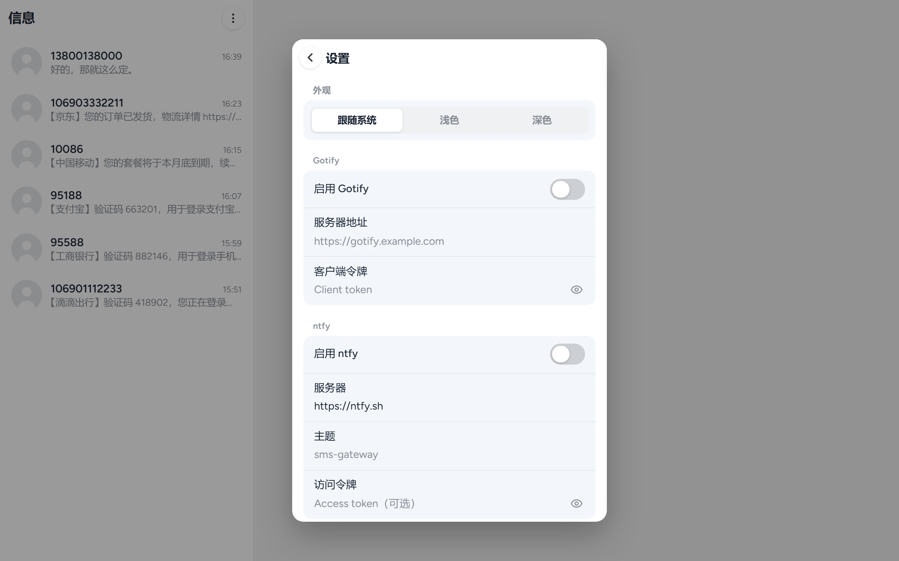

# Smsfy

订阅 **Gotify** / **ntfy** 信息源的类短信应用，支持 PWA 安装，方便在桌面、移动端查看验证码与通知。

可搭配 [sms_forwarding](https://github.com/MineSunshineone/sms_forwarding)（ESP32 + ML307）等转发端使用。

## 文档

- [开发指南](docs/development.md) — 本地运行、脚本、部署
- [转发约定](docs/forwarding.md) — Gotify / ntfy 字段说明

## 截图预览

| 移动端 | 设置 |
| --- | --- |
|  |  |
